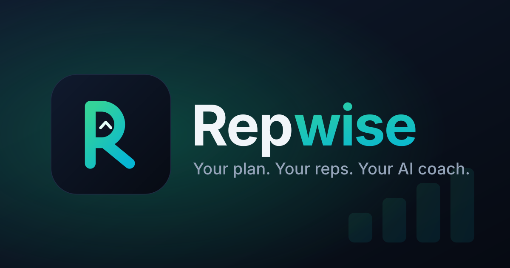

# Repwise — Personal BYOK AI Workout Coach (PWA)

<p align="center"></p>

A zero-backend, personal-use Progressive Web App (Vite + React) powered by your own **Gemini API key**.

## Training log, progression and Ask Your Coach
- **Workout logging:** log weight and reps per set on any exercise card. Weights are stored in kg and shown in your unit; logs are included in backups.
- **Auto-progression (works offline):** double progression. Hit the top of the rep range on every set and the app suggests the next weight; fall well short or log a very hard session and it suggests backing off. Gemini plan generation also sees your recent logs.
- **Ask Your Coach (needs a Gemini key):** free-form questions grounded in your profile, plan and logs. Chat history is kept on the device.
- **Form coaching:** a *Form help* button on every exercise opens the coach focused on that lift, and you can attach up to 3 photos for a form check. Photos are resized in the browser, sent to Gemini with your question and never stored.

## What's New in v2
- **14 Bespoke Parametric SVG Animations:** Dedicated animations for all 38 exercises, including bespoke silhouettes for **Glute Bridge**, **Bilateral Lateral Raise**, **Seated Hamstring Curl**, and **Anti-Rotation Pallof Press**, with Play/Pause, `0.5x` Slow-Mo, and phase scrubbing.
- **Conversational AI Coach Intake (`CoachIntakeChat.jsx`):** Chat naturally about sleep, aches, schedule, and preferences to auto-update your profile before generating a plan.
- **Deeper Vitals + Metric/Imperial Toggle:** Switch seamlessly between `cm / kg` and `ft-in / lbs`, with average sleep hours, stress level, and optional body-fat / BP context folded into readiness scoring.
- **Multi-Week Progressive Training Blocks (`1–4 Weeks`):** Generates structured multi-week progression (RPE, sets, and rep ramps) with Week tabs (`W1–W4`) and phase rules.
- **Custom Free-Text Swap & Adapt Prompts:** Type any ad-hoc constraint (*"Left wrist hurts"*, *"Only 15 min, upper body only"*) alongside one-tap quick chips.
- **Deploy-Ready for Cloudflare Pages & GitHub Pages:** Includes `.gitignore`, `public/_headers`, `.github/workflows/deploy-pages.yml`, and `DEPLOY_HANDOVER.md`.

## Quick Start
```bash
npm install
npm run dev
```
See `DEPLOY_HANDOVER.md` for one-step Cloudflare Pages and GitHub Pages deployment instructions.
